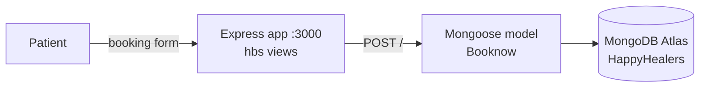

<div align="center">

# 🏥 HappyHealers — Hospital Website & Appointment Booking

**A responsive hospital website with an online appointment-booking form that saves bookings to MongoDB through an Express backend.**


</div>

---

## ✦ Features

- **Hospital site:** home, services, about, doctors, booking and patient reviews, in a single responsive page.
- **Appointment booking:** patients submit their name, phone number, email, date and reason for the visit.
- **Persistence:** bookings are validated with a Mongoose schema (all fields required, one booking per email) and stored in MongoDB.
- **Server-rendered:** Express renders Handlebars (`hbs`) views and serves the static assets.

## ✦ Architecture



## ✦ Getting started

```bash
cd backend
npm install
npm run dev        # nodemon, http://localhost:3000
```

The app connects to the MongoDB database configured in `backend/src/db/conn.js` (project **HappyHealers**, database **test**, collection **booknows**). Point it at your own MongoDB connection string before running it.

## ✦ Project structure

```
backend/
├── src/
│   ├── app.js                 # Express server, routes, view engine
│   ├── db/conn.js             # MongoDB connection
│   └── models/booknow.js      # appointment schema
├── templates/views/           # index.hbs, booked.hbs
└── public/                    # CSS + client-side script
```

---

<div align="center"><sub>Built by <a href="https://github.com/RayaanQ">Rayaan Quraishi</a> · <a href="https://rayaanq.github.io/Portfolio/">Portfolio</a> · <a href="https://www.linkedin.com/in/rayaan-quraishi">LinkedIn</a></sub></div>
